<picture><source media="(prefers-color-scheme: dark)" srcset="assets/nameplate-dark.svg"><source media="(prefers-color-scheme: light)" srcset="assets/nameplate-light.svg"></picture>

<a href="https://www.kaggle.com/ghaisank"><picture><source media="(prefers-color-scheme: dark)" srcset="assets/link-kaggle-dark.svg"><source media="(prefers-color-scheme: light)" srcset="assets/link-kaggle-light.svg"></picture></a>&nbsp;&nbsp;&nbsp;<a href="https://www.linkedin.com/in/ghaisankhoirul"><picture><source media="(prefers-color-scheme: dark)" srcset="assets/link-linkedin-dark.svg"><source media="(prefers-color-scheme: light)" srcset="assets/link-linkedin-light.svg"></picture></a>&nbsp;&nbsp;&nbsp;<a href="https://ghaisan.vercel.app/"><picture><source media="(prefers-color-scheme: dark)" srcset="assets/link-portfolio-dark.svg"><source media="(prefers-color-scheme: light)" srcset="assets/link-portfolio-light.svg"></picture></a>

<picture><source media="(prefers-color-scheme: dark)" srcset="assets/hero-dark.svg"><source media="(prefers-color-scheme: light)" srcset="assets/hero-light.svg"></picture>

<picture><source media="(prefers-color-scheme: dark)" srcset="assets/statement-dark.svg"><source media="(prefers-color-scheme: light)" srcset="assets/statement-light.svg"></picture>

<picture><source media="(prefers-color-scheme: dark)" srcset="assets/redteam-dark.svg"><source media="(prefers-color-scheme: light)" srcset="assets/redteam-light.svg"></picture>

<picture><source media="(prefers-color-scheme: dark)" srcset="assets/quant-dark.svg"><source media="(prefers-color-scheme: light)" srcset="assets/quant-light.svg"></picture>

<picture><source media="(prefers-color-scheme: dark)" srcset="assets/record-dark.svg"><source media="(prefers-color-scheme: light)" srcset="assets/record-light.svg"></picture>

<picture><source media="(prefers-color-scheme: dark)" srcset="assets/closing-dark.svg"><source media="(prefers-color-scheme: light)" srcset="assets/closing-light.svg"></picture>
